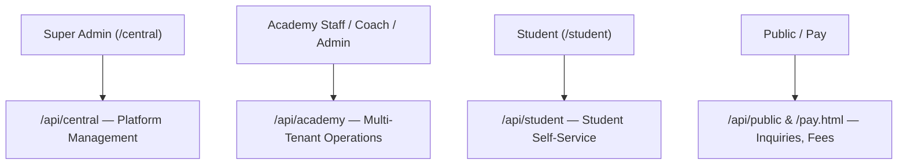

# AGENTS.md — Multi-Tenant Sports SaaS Platform (Pure Node.js + Express + SQLite)

Verified against the current implementation of `node-express-rebuild` on 2026-11-02.
The legacy Laravel/Filament project has been completely removed from this branch.
The application is 100% standalone Node.js Express with physical database-per-tenant SQLite isolation.

## 1. Tech Stack (from package.json)

| Layer              | Technology / Package              | Version |
|---------------------|-----------------------------------|---------|
| Runtime             | Node.js (ES Modules, `type: module`)| ^20 / ^24|
| HTTP Framework      | express                           | ^4.22   |
| Database Engine     | better-sqlite3                    | ^11.10  |
| Authentication      | jsonwebtoken (JWT) + bcryptjs     | ^9.0 / ^2.4 |
| File Uploads        | multer + sharp                    | ^1.4 / ^0.35 |
| Backups & Export    | archiver                          | ^7.0    |
| Testing             | Node.js native test runner (`node:test`) | built-in |
| E2E & Browser Tests | @playwright/test + puppeteer-core | ^1.64 / ^25.3 |
| Frontend            | Vanilla JS SPA (`public/`)         | Static / No-build |

## 2. Panels and Portals



- `/api/central` → Central platform operations: tenant onboarding, subscription plans, quota overrides, domain routing, system audit.
- `/api/academy` → Academy management: branches, coaches, batches, students, attendance, syllabus progression, fees, compensation, shifts, payroll, holidays, equipment.
- `/api/student` → Student self-service: attendance history, syllabus status, fee ledger, event sign-ups, leave requests.
- `/api/auth` → Universal authentication (login, profile, theme customization, logout).
- `/api/public` → Public inquiry creation, branch listing, online invoice payments (`pay.html`).

## 3. Tenant Isolation — Physical Database-Per-Tenant

Tenant model: Dedicated SQLite database per academy.
- Central database: `data/central.db` (contains `academies`, `subscription_plans`, `subscription_plan_limits`, `academy_subscriptions`, `super_admins`, `academy_users_lookup`).
- Tenant database: `data/academies/academy_<id>.db` (each academy has its own isolated SQLite database file).
- Resolved dynamically via `src/db/connectionManager.js`:
  - `getTenantDbById(academyId)`
  - `getTenantDbBySlug(slug)`

Because queries run against an isolated SQLite file for each tenant, cross-tenant data leakage is physically impossible when using `req.academyDb`.

## 4. Authorization & RBAC

Authentication is handled by `src/middleware/auth.js`:
- `authenticateToken`: Validates JWT from `Authorization: Bearer <token>` or cookies. Attaches `req.user` and provisions `req.academyDb`.
- `requireRole(allowedRoles)`: Enforces role-level access (e.g. `requireRole('academy_admin')`).
- `requirePermission(requiredPermissions)`: Enforces granular permission keys (e.g. `view_students`, `assign_user_roles`, `delete_students`).
- Self-role escalation protection: A user cannot alter their own `role` field on `PUT /api/academy/users/:id/role`.
- Wildcard protection: Non-admin users cannot create or assign roles with wildcard `['all']` permissions.

## 5. Directory Structure

```
InternationalSportsSolutions/
├── .agents/
│   ├── AGENTS.md                         # This file
│   └── complete-node-rebuild.md          # 24-Hour Master Specifications & Requirements
├── data/
│   ├── central.db                        # Central platform SQLite database
│   └── academies/
│       └── academy_*.db                  # Tenant-specific SQLite databases
├── public/
│   ├── index.html                        # SPA main application entry
│   ├── pay.html                          # Public fee payment portal
│   ├── css/style.css                     # Responsive styling & themes
│   └── js/app.js                         # Frontend client application logic
├── scripts/                              # Maintenance, migration, and verification scripts
├── src/
│   ├── config/                           # Environment and permission definitions
│   ├── db/
│   │   ├── centralDb.js                  # Central database initialization
│   │   ├── connectionManager.js          # Tenant DB resolution and pool
│   │   ├── migrator.js                   # Automated database migration runner
│   │   ├── migrations/tenant/            # Tenant schema migrations (001-026)
│   │   └── seed.js                       # Platform initialization and seed data
│   ├── middleware/                       # Auth, roles, permissions, tenant context
│   ├── routes/                           # Express route definitions
│   │   ├── academyRoutes.js
│   │   ├── authRoutes.js
│   │   ├── centralRoutes.js
│   │   ├── publicRoutes.js
│   │   ├── staffRoutes.js
│   │   └── studentRoutes.js
│   ├── services/                         # Business logic engines
│   │   ├── attendanceScheduleService.js
│   │   ├── feeService.js
│   │   ├── payrollService.js
│   │   ├── quotaService.js
│   │   ├── scheduleService.js
│   │   └── userService.js
│   └── utils/
│       └── dateUtils.js                  # IST & DD/MM/YYYY standardized date utilities
├── storage/                              # Uploads, payslips, and database backups
├── tests/
│   ├── Unit/                             # Native Node unit tests (303 tests)
│   ├── e2e/                              # Playwright end-to-end browser tests
│   └── qa/                               # Comprehensive QA test suites
├── package.json
└── server.js                             # Express application server
```

## 6. Commands

```bash
npm install                               # Install Node dependencies
npm start                                 # Start production server (port 3005)
npm run server:dev                        # Start server in watch mode
npm run seed                              # Initialize central database and default tenant
npm run migrate                           # Apply database migrations
npm test                                  # Run full test suite (303 unit tests)
npm run test:e2e                          # Run Playwright E2E browser tests
npm run test:qa:roles                     # Run comprehensive role-based QA automation
```

## 7. Master Rules & Conventions

1. **Pure Node.js**: Do not add PHP or Laravel files. The application is completely Node.js + Express.
2. **Standardized Date Handling**: All Indian calendar dates displayed/inputted use `DD/MM/YYYY`. Database columns store `YYYY-MM-DD`. Use `src/utils/dateUtils.js` for safe timezone-aware conversions.
3. **RBAC on Every Endpoint**: Every mutating or sensitive `/api/academy/*` route must specify `requirePermission(...)` or `requireRole(...)`.
4. **Idempotency**: All seeders, migrations, and batch operations must be idempotent and safely re-runnable.
5. **No Regression**: Run `npm test` after all changes. All 303+ unit tests must pass.
