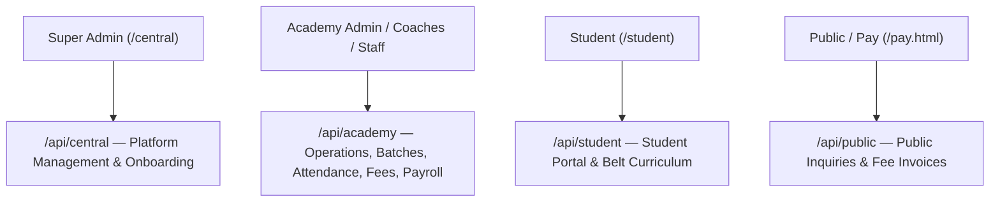

# International Sports Solutions — Multi-Tenant Sports SaaS

[](https://nodejs.org)
[](https://expressjs.com)
[](https://sqlite.org)
[](https://playwright.dev)
[]()

**International Sports Solutions** is a standalone, enterprise-grade multi-tenant SaaS platform built with pure **Node.js + Express** and physical **database-per-tenant SQLite** isolation. It provides comprehensive operations management for sports academies, covering student admissions, batch scheduling, coach shifts & payroll, syllabus progression, facility & equipment tracking, fee ledgers, compliance management, and dynamic branding.

---

## 🚀 Quick Start for New Teammates

👉 **[Click Here to Open the Complete Step-by-Step Local Setup Guide](LOCAL_SETUP_GUIDE.md)**  
*(Includes software download links, Git clone commands, migration steps, local domain setup, and demo login credentials for all roles)*

### Minimal 3-Step Setup:
```bash
# 1. Clone repository & switch to active branch
git clone https://github.com/anilvaja/InternationalSportsSolutions.git
cd InternationalSportsSolutions
git checkout node-express-rebuild

# 2. Install dependencies & initialize databases
npm install
npm run seed
npm run migrate

# 3. Start development server
npm start
```
Open **`http://localhost:3005`** in your browser.

---

## 🏛️ System Architecture



### Key Pillars:
1. **Physical Database-Per-Tenant Isolation:**
   - Central database: `data/central.db` (tenant onboarding, plans, quotas, domains, super admins).
   - Dedicated tenant database: `data/academies/academy_<id>.db` (each academy has its own isolated SQLite database file).
   - Dynamic connection routing via `src/db/connectionManager.js`. Cross-tenant data leakage is physically impossible.
2. **Granular RBAC Authorization:**
   - Route-level middleware (`requireRole`, `requirePermission`) with strict protection against self-role escalation and wildcard assignment.
3. **Standardized Calendar & Date Format:**
   - Database stores ISO `YYYY-MM-DD`.
   - All client inputs, displays, and reports use Indian Standard Time (`Asia/Kolkata`) in `DD/MM/YYYY`.

---

## 📱 Portals & Default Login Credentials

| Portal | URL | Demo Account | Password | Role |
|---|---|---|---|---|
| **Academy Portal** | `http://localhost:3005/` | `admin@pratikkarate.com` | `password123` | Academy Admin |
| **Super Admin Panel** | `http://localhost:3005/central` | `anilvaja.007@gmail.com` | `password` | Super Admin |
| **Coach Workspace** | `http://localhost:3005/` | `rajesh.kumite@pratikkarate.com` | `coach123` | Coach |
| **Finance Manager** | `http://localhost:3005/` | `anita.finance@pratikkarate.com` | `staff123` | Finance Manager |
| **Front Desk** | `http://localhost:3005/` | `vikram.staff@pratikkarate.com` | `staff123` | Front Desk |
| **Student Self-Service** | `http://localhost:3005/student` | `aarav.mehta@demostudent.iss` | `student123` | Student |
| **Public Pay Portal** | `http://localhost:3005/pay.html` | *Public Access* | *N/A* | Public Invoice Pay |

---

## 🧪 Testing Suites

```bash
# Run 328 Node.js unit tests (0 failures)
npm test

# Run comprehensive Playwright browser QA across all 9 user roles (33 workflows)
npm run test:qa:roles

# Run visual headed browser verification
npm run test:visual
```

---

## 📚 Project Documentation
- **[LOCAL_SETUP_GUIDE.md](LOCAL_SETUP_GUIDE.md)** — Step-by-step local setup for new developers.
- **[docs/NODEJS_ARCHITECTURE.md](docs/NODEJS_ARCHITECTURE.md)** — In-depth architectural blueprint.
- **[docs/TECHNOLOGY_MIGRATION_REPORT.md](docs/TECHNOLOGY_MIGRATION_REPORT.md)** — Legacy Laravel elimination report.
- **[docs/QUALITY_ASSURANCE_MASTER_REPORT.md](docs/QUALITY_ASSURANCE_MASTER_REPORT.md)** — QA test matrix and audit remediations.
- **[docs/BUG_TRACKER.csv](docs/BUG_TRACKER.csv)** — Audit finding resolution tracker.
