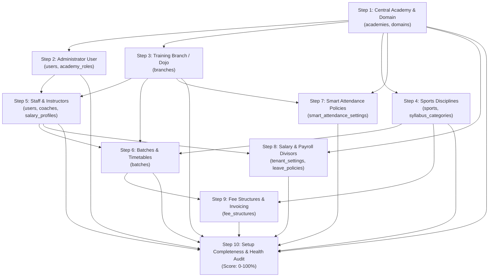

# STAGE 2: ACADEMY SETUP DEPENDENCY SEQUENCE & READINESS DIRECTORY

**Target Feature:** 10-Step Guided Academy Setup Wizard & Completeness Dashboard  
**Service Implementation:** `src/services/academySetupWizardService.js`  
**Frontend UI Controller:** `public/js/setupWizard.js`  
**API Endpoints:** `GET /api/central/setup-wizard/defaults`, `POST /api/central/setup-wizard/provision`, `GET /api/academy/setup/completeness`  

---

## 1. Setup Dependency Graph (DAG)

Because SQLite enforces `PRAGMA foreign_keys = ON`, records must be provisioned in a strict dependency sequence to avoid foreign key violations.

---

## 2. Step-by-Step Provisioning Sequence & Database Specifications

### Step 1: Academy Organization & Core Profile
- **Tables Modified:** `central.academies`, `central.domains`, `tenant.tenant_settings`
- **Mandatory Fields:** `name`, `slug`, `contact_email`, `plan`, `timezone` (`Asia/Kolkata`), `currency` (`INR`)
- **Optional / Configurable:** `contact_phone`, `address`, `city`, `state`, `country`, `logo_url`, `custom_domain`, `is_gst_registered`, `gst_number`, `legal_business_name`
- **Verification Rule:** `slug` must be globally unique across all academies in `central.db`.

### Step 2: Academy Administrator Account
- **Tables Modified:** `tenant.users`, `central.academy_users_lookup`
- **Mandatory Fields:** `admin_name`, `admin_email`, `admin_password` (min 6 characters, hashed with `bcryptjs`)
- **Role Assigned:** `academy_admin`
- **Verification Rule:** `admin_email` must be indexed in `central.academy_users_lookup` to allow immediate portal login.

### Step 3: Physical Branches & GPS Geofences
- **Tables Modified:** `tenant.branches`
- **Mandatory Fields:** `name` (e.g. `Main Dojo`), `is_active = 1`
- **Optional / Configurable:** `address`, `phone`, `latitude`, `longitude`, `geofence_radius_meters` (default 150m), `is_geofence_enforced` (0 or 1)
- **Dependency Note:** At least 1 branch must exist before batches can be created.

### Step 4: Sports Curriculum & Syllabus Hierarchy
- **Tables Modified:** `tenant.sports`, `tenant.syllabus_categories`
- **Mandatory Fields:** `sports.name` (case-insensitive check: `SELECT id FROM sports WHERE LOWER(name) = LOWER(?)`)
- **Optional / Configurable:** `description`, `defaultCategories` (e.g., `Beginner`, `Intermediate`, `Advanced`, or `Kata`, `Kumite`, `Bunkai`)
- **Dependency Note:** Sport must be committed before `syllabus_categories` can insert with `sport_id`.

### Step 5: Staff, Instructors & Compensation Profiles
- **Tables Modified:** `tenant.users`, `tenant.coaches`, `tenant.staff_salary_profiles`, `tenant.employee_leave_balances`, `central.academy_users_lookup`
- **Mandatory Fields:** `name`, `email`, `role` (`coach`, `head_coach`, `trainer`, `front_desk`, `accountant`)
- **Optional / Configurable:** `phone`, `compensation_mode` (`monthly`, `daily`, `hourly`, `per_minute`, `per_session`), `salary_amount`, `joining_date`, `branch_id`
- **Dependency Note:** `branch_id` must reference a valid branch from Step 3.

### Step 6: Training Batches & Timetables
- **Tables Modified:** `tenant.batches`
- **Mandatory Fields:** `name`, `branch_id`, `max_capacity` (default 30), `start_time` (`HH:MM`), `end_time` (`HH:MM`), `days_of_week` (`Mon, Wed, Fri`)
- **Optional / Configurable:** `sport_id`, `coach_id`, `assistant_coach_id`
- **Dependency Note:** Must reference valid `branch_id` (Step 3), `sport_id` (Step 4), and `coach_id` (Step 5).

### Step 7: Smart Attendance Engine Policies
- **Tables Modified:** `tenant.smart_attendance_settings`
- **Mandatory Fields:** `academy_id`, `branch_id` (null for academy-wide defaults)
- **Configurable Settings:**
  - `enabled_modes`: JSON array (`['qr', 'coach_manual', 'gps', 'nfc', 'face']`)
  - `default_mode`: string (`qr`)
  - `duplicate_cooldown_mins`: integer (default 15 mins)
  - `checkin_window_before_mins`: integer (default 30 mins)
  - `late_threshold_mins`: integer (default 15 mins)
  - `face_liveness_required`: boolean (1)

### Step 8: Salary & Payroll Configuration
- **Tables Modified:** `tenant.tenant_settings`, `tenant.leave_policies`
- **Configurable Settings:**
  - `payroll_salary_divisor_mode`: `calendar_days`, `working_days`, `fixed_30`, or `custom`
  - `payroll_custom_divisor`: integer (default 26)
  - `payroll_overtime_multiplier`: float (default 1.0 or 1.25)
  - `payroll_auto_checkout_hours`: integer (default 12 hours)
  - Default leave policies seeded: `Casual Leave` (12), `Sick Leave` (12), `Earned Leave` (15).

### Step 9: Fee Structures & Invoicing Plans
- **Tables Modified:** `tenant.fee_structures`
- **Mandatory Fields:** `name`, `billing_frequency` (`monthly`), `amount` (e.g. ₹2,000)
- **Optional / Configurable:** `sport_id`, `admission_fee`, `receipt_prefix`

### Step 10: Setup Completeness & Health Audit
- **Service Method:** `AcademySetupWizardService.getAcademySetupCompleteness(db, academyId)`
- **Evaluation Criteria (Total Score: 100%):**
  1. `admin_account` (Weight: 15%) - Designated active user with `academy_admin` role
  2. `branches` (Weight: 15%) - At least one active physical training facility (`is_active = 1`)
  3. `sports` (Weight: 15%) - At least one active sport discipline (`is_active = 1`)
  4. `coaches` (Weight: 15%) - At least one active instructor with salary profile
  5. `batches` (Weight: 15%) - At least one active training batch linked to branch and sport
  6. `smart_attendance` (Weight: 10%) - Smart attendance rules configured
  7. `payroll_settings` (Weight: 10%) - Configured working days divisor and leave policies
  8. `fee_structures` (Weight: 5%) - Fee plan defined for student billing
- **Thresholds:**
  - Score >= 85%: `isOperationallyReady = true` (Academy ready to admit students and collect fees)
  - Score = 100%: `isFullyConfigured = true`
