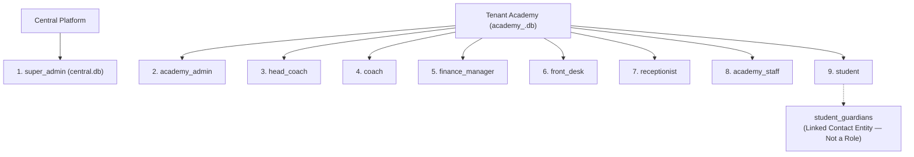

# CANONICAL ROLE INVENTORY & IDENTITY ARCHITECTURE

**Platform:** Multi-Tenant Sports SaaS (`InternationalSportsSolutions`)  
**Architecture:** Pure Node.js (ESM) + Express + `better-sqlite3` with Physical Database-per-Tenant Isolation  
**Date of Audit:** November 13, 2026  
**Status:** **AUTHORITATIVE CANONICAL REFERENCE**

---

## 1. Executive Summary & Role Count Resolution

A key discrepancy addressed during the Stage 2 Acceptance Review was resolving whether the platform has 8 or 9 roles, and how parent accounts are modeled.

### The Canonical Count
- **Central Platform Layer:** **1 Platform Role** (`super_admin`), stored in `data/central.db` table `super_admins`.
- **Tenant Academy Layer:** **8 Tenant Operational Roles**, defined in `src/config/permissions.js` (`DEFAULT_ACADEMY_ROLES`) and persisted in `academy_roles` inside each tenant database (`data/academies/academy_<id>.db`).
- **Total Unique Authentication Roles:** **9 Platform Roles** (1 Central + 8 Academy).

### What About Parents?
- **Parent is NOT a role** in `academy_roles` or `users.role`.
- Parents/Guardians are modeled as **student-linked contact and emergency entities** in the dedicated table `student_guardians` (columns: `id`, `student_id`, `name`, `relationship`, `phone`, `email`, `is_primary`, `is_emergency_contact`, `authorized_pickup`).
- In public inquiry, fee payment notifications (`pay.html`), and student admission flows, communications target the parent's phone/email linked via `student_guardians`.

---

## 2. Platform Central Role (1 Role)

| Role Key | Layer | Storage Location | Capabilities & Scope |
|---|---|---|---|
| `super_admin` | Central Platform | `central.db` (`super_admins`) | Multi-tenant SaaS administration: onboarding academies, managing subscription tiers, quota limit overrides, domain routing, central system audit logs. Cannot access tenant day-to-day operations unless elevated through explicit academy context. |

---

## 3. Tenant Academy Roles (8 Roles)

Every tenant database initializes with these 8 canonical roles in `academy_roles`.

| # | Role Key | Display Name | System Role | Category | Granular Capabilities & Access Scope |
|---|---|---|---|---|---|
| 1 | `academy_admin` | Academy Administrator | Yes (`is_system = 1`) | Executive | Unrestricted administrative access across all tenant modules: branches, staff, payroll, students, curriculum, billing, settings, and audits. |
| 2 | `head_coach` | Head Coach / Technical Director | Yes (`is_system = 1`) | Coaching | Senior coaching authority: curriculum design, syllabus categories/techniques, belt grading promotions, supervising coach assignments, taking attendance. Cannot alter billing, salary structures, or tenant settings. |
| 3 | `coach` | Sports Coach / Instructor | Yes (`is_system = 1`) | Coaching | Batch training execution: viewing assigned batches, taking student batch attendance, tracking technique progression, self-service duty punches, viewing personal salary statements. Scoped strictly to assigned batches. |
| 4 | `finance_manager` | Finance & Accounts Manager | No (`is_system = 0`) | Administration | Complete billing and financial authority: student fee ledgers, fee collections, invoice generation, discount presets, payment receipts, GST reports. No coaching or curriculum modification rights. |
| 5 | `front_desk` | Front Desk Executive | No (`is_system = 0`) | Operations | Reception operations: parent inquiries, admission leads, student registrations, student lookups, check-in kiosk assistance. No access to financial payroll or academy configuration settings. |
| 6 | `receptionist` | Receptionist | Yes (`is_system = 1`) | Operations | Front-of-house customer service: student lookups, check-ins, fee collection intake, logging parent phone/walk-in inquiries. |
| 7 | `academy_staff` | Operational Staff / Facility Crew | Yes (`is_system = 1`) | Operations | General facility and equipment operations: equipment checkouts, self-service duty attendance punches, viewing facility schedules. Restricted from sensitive data. |
| 8 | `student` | Student Self-Service Portal | Yes (`is_system = 1`) | Student Self-Service | Personal student portal: viewing enrolled batches, personal attendance history, belt progression syllabus, digital ID attendance QR card, downloading belt certificates (jsPDF), viewing invoices. Scoped strictly to `req.user.student_id`. |

---

## 4. RBAC Permission Mapping Architecture

Each tenant role's permissions are stored in JSON format in `academy_roles.permissions`.

### Permission Categories in `src/config/permissions.js`
1. **Students & Admissions:** `view_students`, `create_students`, `edit_students`, `delete_students`, `view_inquiries`, `manage_inquiries`
2. **Attendance & Progress:** `view_attendance`, `take_attendance`, `edit_attendance`, `manage_syllabus`
3. **Batches & Facilities:** `view_batches`, `manage_batches`, `view_branches`, `manage_branches`
4. **Coaches & Staff:** `view_coaches`, `manage_coaches`, `view_staff`, `manage_staff`
5. **Billing & Fees:** `view_fees`, `collect_fees`, `manage_fee_structures`, `manage_discounts`
6. **Payroll & Compensation:** `view_payroll`, `manage_payroll`, `approve_overtime`, `approve_leaves`
7. **System & Administration:** `view_settings`, `manage_settings`, `view_audit_logs`, `manage_roles`

---

## 5. Summary Matrix: The 9 Canonical Roles

